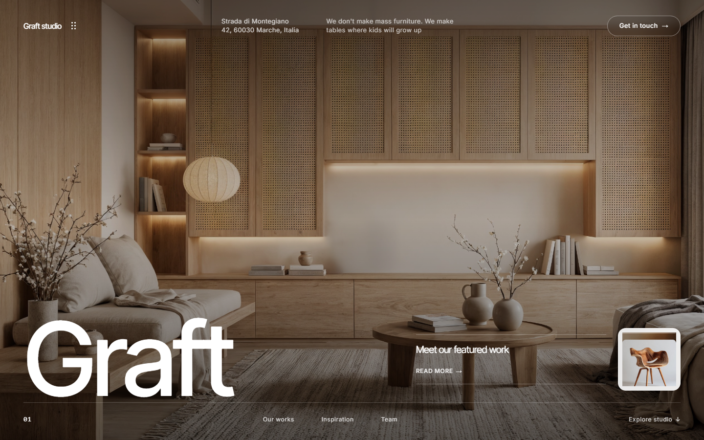

# Graft — Scandinavian & Italian Craft Furniture Studio

A production-grade, interactive web replica of the **Graft** furniture studio website (originally designed by Stacy More on Framer), faithfully reconstructed from the visual analysis of `E:\Furniture.mp4`.



---

## 🌟 Key Features

1. **Interactive Three.js 3D Spotlight (`Onda Chair`)**
   - 360° mouse & touch orbit rotation with smooth inertia dampening
   - Studio 3-point lighting setup with soft contact floor shadows
   - Real-time swatch changer: **Natural Matte Oak**, **Smoked Walnut**, **Bleached Nordic Ash**, and **Sienna Cognac Leather**
   - High-resolution Studio Gallery toggle and architectural spec panel

2. **Kinetic Inertia Smooth Scrolling**
   - Powered by **Lenis**, delivering an organic, physics-based scroll feel identical to Framer

3. **Morphing Header & Fullscreen Navigation Drawer**
   - Seamless transition from transparent header over hero photography to an Espresso Dark (`#392615`) floating pill bar with rounded corners
   - 6-dot menu icon opens a fullscreen navigation drawer with numbered links and smooth-scrolling jumps

4. **11 Complete Content Sections**
   - **01. Hero:** Display typography, teaser card, floating Onda chair pill
   - **02. Categories:** Staggered typography with interactive capsule image pills (*Sofas, Sidetables, Chairs, Tables, Dressing Room, Beds*)
   - **03. Catalog Slider:** Tactile architecture slider with *Toma Cabinet*, *Riva Lamp*, and *Alden Chair*
   - **04. Onda 3D Spotlight:** WebGL Three.js interactive chair model and spec sheet
   - **05. Projects Showcase:** Editorial loft interiors with floating 5-star review cards
   - **06. Services Grid:** Bespoke fabrication, Spatial planning, Material sourcing, Restorations
   - **07. Craftsmanship Process:** 4-step craft timeline (*Reach out, Design, Craft, Delivery*)
   - **08. Testimonials & Metrics:** Live counters (`21` bespoke pieces, `16` full interiors) and wood sculpture visual
   - **09. Team & Moodboard:** Master craftsmen portrait cards and woodworking masonry moodboard
   - **10. Contact Section:** Floating contact inquiry card with input validation
   - **11. Footer & Social Hub:** Instagram grid, oversized `Graft.` watermark, newsletter form, back-to-top button

---

## 🛠️ Tech Stack

- **Framework:** React 19 + TypeScript + Vite
- **Styling:** Tailwind CSS v4 (`@tailwindcss/vite`)
- **Animations:** Framer Motion
- **Smooth Scroll:** `@studio-freight/lenis`
- **3D Graphics:** Three.js
- **Icons:** Lucide React
- **Testing:** Playwright (Python visual verification suite)

---

## 🚀 Getting Started

### 1. Install Dependencies
```bash
cd app
npm install
```

### 2. Start Development Server
```bash
npm run dev
```
The site will run at `http://localhost:5173/`.

### 3. Build & Preview Production Bundle
```bash
npm run build
npm run preview
```

---

## 🧪 Visual Verification Suite

An automated Playwright script is included to capture high-resolution screenshots of all 11 sections:

```bash
python test_demo.py
```
Generated screenshots are saved in `verification_screens/`:
- `01_hero.png`
- `02_categories.png`
- `03_catalog.png`
- `04_onda_3d.png`
- `04_onda_3d_walnut.png`
- `05_projects.png`
- `06_services_process.png`
- `08_team_moodboard.png`
- `09_contact.png`
- `10_footer.png`
- `11_menu_drawer.png`

---

## 📁 Repository Structure

```
d:\FurnitureDemo\
├── app/
│   ├── public/
│   │   └── assets/             # Original raw uncompressed images & textures
│   ├── src/
│   │   ├── components/
│   │   │   ├── Navbar.tsx
│   │   │   ├── Hero.tsx
│   │   │   ├── Categories.tsx
│   │   │   ├── CatalogSlider.tsx
│   │   │   ├── Onda3DSpotlight.tsx
│   │   │   ├── ProjectsShowcase.tsx
│   │   │   ├── ServicesProcess.tsx
│   │   │   ├── TestimonialsMetrics.tsx
│   │   │   ├── TeamMoodboard.tsx
│   │   │   ├── ContactSection.tsx
│   │   │   ├── FooterSocial.tsx
│   │   │   └── SmoothScroll.tsx
│   │   ├── App.tsx
│   │   ├── index.css
│   │   └── main.tsx
│   ├── index.html
│   ├── package.json
│   └── vite.config.ts
├── verification_screens/       # Automated Playwright test captures
├── test_demo.py                # Visual regression & screenshot script
├── map_clean_assets.py         # Asset ingestion pipeline
└── README.md
```
